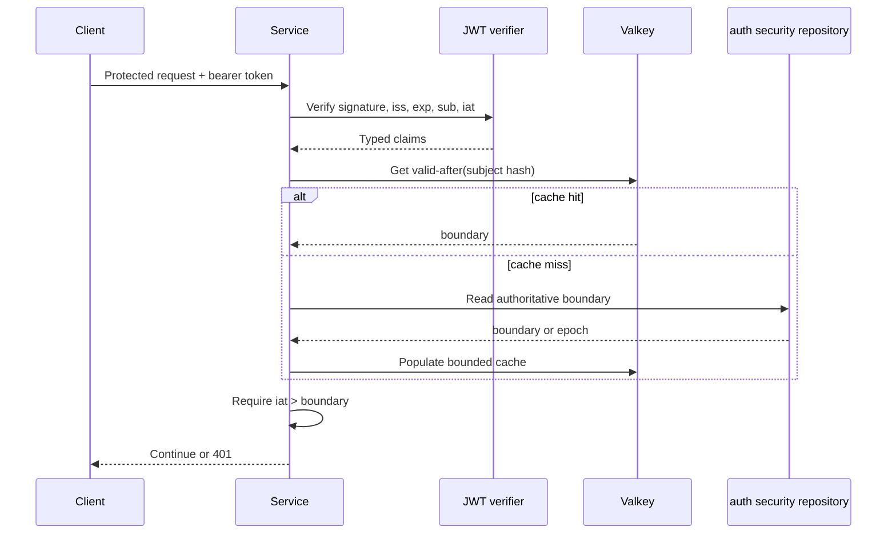

# RR-34 Detail Design: Timestamp-Based Token Revocation

## Status

- ID: `DESIGN-RR-34`
- Status: `draft`
- Ticket: [RR-34](./ticket.md)
- Approval: `pending`
- Author: AI
- Updated: 2026-06-07

## Problem

Signed JWT access tokens are self-contained. Signature and expiry validation do
not observe a later logout or security decision, so an already issued token can
remain usable until `exp`. Runtime Roasters needs immediate user-wide revocation
without retaining JWTs or maintaining a blacklist entry for every token.

Success means every protected HTTP and gRPC request compares the token's issue
time to a server-controlled subject boundary, old Hydra grants cannot bypass
that boundary by refreshing, and the security action is auditable without
capturing credentials.

## Context Loaded

- `docs/CONTEXT.md`
- `docs/work/BACKLOG.md`
- `docs/standards/README.md`
- `docs/standards/QUALITY_BAR.md`
- `docs/standards/VALIDATION.md`
- `docs/standards/DEBUGGING.md`
- `docs/work/tickets/sprint11/main.md`
- `docs/requirements/REQUIREMENTS.md`
- `docs/requirements/SPEC.md`
- `docs/architecture/API.md`
- `docs/architecture/ERD.md`
- `docs/architecture/SDD/README.md`
- `docs/decisions/0006-two-gate-authz-casbin.md`
- `src/pkg/base/auth/`
- `src/pkg/base/identity/`
- `src/pkg/base/security/http.go`
- `src/apps/auth-service/`
- Hydra Go SDK v2.2.1 session/consent revocation contracts
- RFC 7519 `iat` semantics and RFC 7009 revocation constraints

## Brownfield Scope

- Touched modules: auth-service domain/repository/use case/transport, auth
  migration, shared identity claims, shared HTTP/gRPC authentication, shared
  service bootstrap options, Valkey client integration, Hydra adapter, audit
  publication, gateway routes, and focused tests.
- Direct dependencies: Hydra/Kratos login flow, JWKS verification, Casbin admin
  authorization, PostgreSQL `auth_db`, Valkey, audit-service event ingestion,
  KrakenD, and all services using shared auth middleware.
- Contracts affected: required JWT claims, protected-request authentication,
  two revoke-all APIs, auth security-state schema, and security audit event.
- Known unknowns: the configured Hydra token claims must be verified in a live
  issued access token before implementation; current parsing does not expose
  `iat`, `exp`, `auth_time`, or `sid` in `identity.Claims`.
- Scope expansion reason: shared middleware is required because service-local
  enforcement would create inconsistent revocation behavior.

## Small Task Exemption

- Small task exemption: no
- Reason: this is a security, API, data, runtime, and shared framework change.
- Impact checked: API=yes, DB=yes, Security=yes, Runtime=yes, Standards=no

## Security Model

### Invariant

A token is acceptable only when all normal JWT checks pass and:

```text
token.iat > subject.tokens_valid_after
```

`iat <= tokens_valid_after` is revoked. The comparison is deliberately strict
because JWT NumericDate values have second precision and a token minted in the
same second as a revoke operation must not survive ambiguously.

### Revocation Granularity

This ticket implements user-wide revocation. One boundary invalidates every
access token issued to the subject at or before that time. It does not support
selecting one `jti`, client device, or `sid`.

### Source Of Truth

PostgreSQL `auth_db` owns security state. Valkey is a performance cache only.
No JWT, refresh token, ID token, authorization code, or token hash is written to
either store.

## Data Design

Add an auth-service migration for:

```sql
CREATE TABLE user_security_states (
    subject             TEXT PRIMARY KEY,
    tokens_valid_after  TIMESTAMPTZ NOT NULL DEFAULT 'epoch',
    reason              TEXT NOT NULL DEFAULT '',
    updated_by          TEXT NOT NULL,
    updated_at          TIMESTAMPTZ NOT NULL DEFAULT CURRENT_TIMESTAMP,
    version             BIGINT NOT NULL DEFAULT 1
);
```

Rules:

- `subject` is the Hydra/Kratos subject identifier.
- Missing rows mean epoch/no revocation and may be created lazily.
- Updates use PostgreSQL time and are monotonic:
  `tokens_valid_after = GREATEST(tokens_valid_after, database_now)`.
- `version` increments on effective updates and supports cache invalidation and
  audit correlation.
- The table contains security state, not identity profile data or token data.
- Repository methods must use a transaction and return the committed database
  timestamp, never a client-provided revoke timestamp.

## Claim Contract

Extend `identity.Claims` with typed times:

```text
IssuedAt  time.Time
ExpiresAt time.Time
```

JWT parsing must:

1. Continue verifying signature algorithm, `kid`, JWKS key, issuer, and `exp`.
2. Require non-empty `sub` and numeric `iat`/`exp`.
3. Reject `iat` beyond an approved small clock-skew allowance.
4. Preserve `jti` only for correlation/replay features; revocation does not
   depend on it.
5. Never log the raw bearer token.

`auth_time` and `sid` may be parsed later for session-level revocation but are
not part of this ticket's acceptance contract.

## Cache Design

Valkey key:

```text
auth:valid-after:v1:{sha256(subject)}
```

Value is a versioned structured payload containing Unix seconds and state
version. Hashing avoids exposing raw subject identifiers in operational key
listings; it is not used as a security boundary.

- Cache hit: compare without PostgreSQL access.
- Cache miss: read PostgreSQL, cache the result, then compare.
- Successful revoke: commit PostgreSQL first, then write-through the new cache
  value. The database commit is never rolled back because cache update failed.
- Cache TTL: configurable and bounded, proposed default 15 minutes with jitter.
- Revocation endpoint returns failure if the authoritative update or Hydra
  invalidation fails. Cache write failure is recorded and returned as partial
  operational failure only after the database boundary is durable.
- Protected request behavior is fail closed when a miss cannot be resolved from
  PostgreSQL. A stale cache value is not extended after its TTL.
- Add singleflight/request coalescing per subject to prevent cache-miss storms.

## API Design

### Self-Service Revoke All

```text
POST /v1/auth/security/revoke-all
Authorization: Bearer <access-token>
Content-Type: application/json

{
  "reason": "user_logout_all"
}
```

- Subject is taken only from the verified token, never from the request body.
- Returns `204 No Content` after the boundary is committed and Hydra revocation
  succeeds.
- Repeated calls are idempotent and may advance the boundary but cannot weaken
  prior revocation.

### Administrative Revoke All

```text
POST /v1/admin/users/{subject}/security/revoke-all
Authorization: Bearer <admin-token>
Content-Type: application/json

{
  "reason": "suspected_compromise"
}
```

- Requires existing administrator authentication and Casbin policy.
- `reason` is required and length-limited; it must not contain token material.
- Unknown subjects return a non-enumerating response consistent with the
  existing admin user contract.
- Response body may return `subject`, `tokens_valid_after`, and `version`; it
  must not return claims or credentials.

Exact protobuf/HTTP DTOs and status mapping must be added to the API master doc
during implementation. The gateway must not expose Hydra admin APIs directly.

## Revocation Sequence

```mermaid
sequenceDiagram
    actor Actor
    participant Gateway as KrakenD
    participant Auth as auth-service
    participant DB as PostgreSQL auth_db
    participant Cache as Valkey
    participant Hydra as Ory Hydra Admin
    participant Audit as audit-service

    Actor->>Gateway: POST revoke-all with JWT
    Gateway->>Auth: Authenticated request
    Auth->>Auth: Authorize actor and resolve subject
    Auth->>DB: Advance tokens_valid_after using DB time
    DB-->>Auth: Committed boundary + version
    Auth->>Cache: Write-through boundary
    Auth->>Hydra: Revoke login sessions by subject
    Auth->>Hydra: Revoke all consent sessions by subject
    Auth->>Audit: Publish security.token_revoked
    Auth-->>Gateway: 204 or explicit partial failure
```

The boundary is committed before external invalidation so already issued access
tokens are blocked immediately by Runtime Roasters services. Hydra login and
consent revocation prevents old grants/sessions from producing later tokens.

## Protected Request Sequence



## Hydra Integration

Use Hydra v2.2.1 administrative APIs already present in the module:

- `RevokeOAuth2LoginSessions(...).Subject(subject)` to terminate subject login
  sessions.
- `RevokeOAuth2ConsentSessions(...).Subject(subject).All(true)` to invalidate
  grants and associated access tokens across clients.

Implementation must verify exact SDK request builders against the pinned module
and a live Hydra instance. The token-string RFC 7009 endpoint is not the primary
mechanism because this design intentionally does not receive or store every
refresh token.

## Shared Middleware Integration

Replace the optional per-`jti` `BlacklistChecker` path with a generic
`TokenValidityChecker` accepting typed claims. Wire it through shared HTTP and
gRPC middleware and every protected service bootstrap.

To avoid direct PostgreSQL connections from every domain service, introduce an
auth-owned validity provider with:

- local Valkey lookup for the common path;
- an internal auth-service lookup fallback for authoritative cache misses;
- strict timeout and fail-closed behavior;
- no public gateway route for the internal lookup.

The implementation design must not make each domain service own or migrate the
auth security table. Auth-service remains the only writer.

## Failure Handling

| Failure | Required behavior |
| --- | --- |
| Invalid/missing `sub`, `iat`, or `exp` | Reject as unauthenticated |
| Token expired or issued too far in future | Reject as unauthenticated |
| Valkey hit, token before boundary | Reject as unauthenticated |
| Valkey miss, auth lookup succeeds | Cache and continue comparison |
| Valkey unavailable, auth lookup succeeds | Compare authoritative result; record degraded cache |
| Valkey and authoritative lookup unavailable | Fail closed; do not execute protected operation |
| PostgreSQL revoke update fails | Return failure; do not claim revocation |
| Boundary committed, cache write fails | Continue Hydra invalidation; report/alert degraded cache |
| Boundary committed, Hydra revocation fails | Old access tokens remain blocked; return retryable partial failure and persist retry work |
| Audit publication fails | Use transactional outbox/retry; do not undo security boundary |

Hydra invalidation requires a durable retry record/outbox because PostgreSQL and
Hydra cannot share one transaction. Repeating the operation must be safe.

## Audit Event

Publish `security.token_revocation.requested` and final
`security.token_revocation.completed`/`failed` events through an auth outbox.
Payload fields:

- event ID and trace/correlation ID
- actor subject and actor role
- target subject
- scope: `ALL_SUBJECT_SESSIONS`
- reason code and sanitized reason text
- committed `tokens_valid_after` and version
- Hydra invalidation result
- timestamp and source service

Explicitly excluded: bearer token, refresh token, ID token, authorization code,
cookie, client secret, and full JWT claims.

## Rollout And Compatibility

1. Add migration and repository with epoch default semantics.
2. Add typed `iat`/`exp` parsing and tests; observe live Hydra token shape.
3. Deploy validity provider in report-only mode to compare decisions without
   rejecting requests.
4. Wire all protected HTTP/gRPC services and prove cache/lookup health.
5. Enable enforcement with fail-closed behavior.
6. Enable self/admin revoke endpoints and Hydra retry worker.
7. Remove the unused per-`jti` blacklist only after repository-wide references
   and rollback needs are reviewed.

Legacy valid tokens with no `iat` will be rejected once enforcement is enabled.
The report-only stage must confirm Hydra always issues required claims before
that switch.

## Alternatives Considered

| Alternative | Pros | Cons | Decision |
| --- | --- | --- | --- |
| Store raw JWTs | Exact matching | Credential exposure and unbounded sensitive storage | Rejected |
| Per-`jti` Valkey blacklist | Revokes one token precisely | State grows per token; requires JTI coverage and wiring | Rejected for RR-34 |
| Short-lived access tokens only | Stateless resource services | Revocation is delayed until expiry | Rejected as sole control |
| Hydra introspection on every request | Central immediate state | Adds network dependency and latency to every protected call | Rejected |
| User `token_version` integer claim | Cheap comparison | New token must embed synchronized version; similar state but harder Hydra claim integration | Deferred alternative |
| User `tokens_valid_after` timestamp | Constant state per subject, simple `iat` comparison, no token storage | Revokes all subject sessions and requires clock discipline/backend lookup | Selected |

## Impacted Areas

- Code/modules: auth-service, shared identity/auth/security packages, service
  bootstraps, Valkey integration, Hydra adapter, audit outbox, gateway, tests.
- Product behavior: logout-all and administrator security response become
  immediate across protected APIs.
- API/contracts: two revoke-all endpoints and required JWT `iat` claim.
- Data/schema: auth-owned `user_security_states` and durable Hydra retry/outbox
  records.
- Security/auth: fail-closed timestamp enforcement and subject-wide invalidation.
- Deployment/runtime: Valkey/auth lookup dependencies, Hydra admin connectivity,
  cache TTL/timeouts, metrics, alerts, and clock synchronization.
- Docs: requirements, API, ERD, SDD, ADR, runbook, validation matrix, release
  notes, context, backlog, ticket evidence.

## Test Plan

### Unit

- Parse valid `iat`/`exp`; reject missing, wrong type, expired, and future claims.
- Boundary cases: `iat = boundary-1`, `iat = boundary`, `iat = boundary+1`.
- Monotonic revoke update and repeated idempotent calls.
- Self-service subject cannot be overridden by request data.
- Administrator authorization and reason validation.
- Cache hit/miss/write-through/TTL and malformed cache payload.
- Fail-closed dependency errors and sanitized logs/audit events.

### Integration

- Apply auth migration to fresh PostgreSQL and test concurrent revoke updates.
- Run live Valkey cache tests and prove no raw subject/token value is stored.
- HTTP and gRPC middleware reject old tokens consistently.
- Hydra live test revokes subject login/consent sessions and blocks refresh.
- Outbox retries Hydra/audit failure without weakening the committed boundary.

### E2E And UAT

1. Login through Hydra/Kratos and call a protected API successfully.
2. Invoke self revoke-all.
3. Repeat the protected call with the original access token and receive `401`.
4. Attempt refresh/old session continuation and prove it cannot mint a usable
   token.
5. Login again and prove a new token with `iat > boundary` succeeds.
6. Repeat using admin revoke against another subject and verify authorization
   denial for a non-admin actor.

### Security Audit

- Search logs, audit payloads, PostgreSQL, and Valkey for token material.
- Verify issuer/signature/algorithm/expiry checks remain active.
- Verify no protected service omits the validity checker.
- Verify internal validity lookup and Hydra admin endpoints are not public.
- Verify timeout, dependency outage, cache poisoning, and replay behavior.
- Run focused Go tests with `-race` for shared cache/provider concurrency.

## Validation Matrix Impact

- Update required: yes
- Add row: `Timestamp-Based Token Revocation`
- Required proof: unit, PostgreSQL/Valkey/Hydra integration, HTTP/gRPC negative
  security tests, E2E/UAT, platform outage behavior, and docs review.

## Reconciliation Plan

- Requirements: update `REQ-AUTH-001` behavior and add explicit revocation
  acceptance if needed.
- Architecture/SDD: document validity boundary ownership and request/revoke
  sequences.
- API: document both endpoints, authorization, payloads, statuses, and errors.
- ERD: add `user_security_states` and durable retry/outbox ownership.
- ADR: create timestamp-based token revocation ADR before implementation.
- Operations: document cache/Hydra outage response, retry worker, metrics, and
  clock requirements.
- Work docs: create test verification/docs review, update matrix, release notes,
  context, backlog, and ticket status.

## Approval Gate

Implementation must not begin until the human approves this design. Approval
must confirm:

- user-wide revocation is sufficient for RR-34;
- `iat <= tokens_valid_after` is the accepted boundary rule;
- PostgreSQL is source of truth and Valkey is cache;
- protected requests fail closed when authoritative validity cannot be checked;
- Hydra login and consent sessions are both revoked;
- per-device/session and single-`jti` revocation remain out of scope.

## Verification Results

- Command: `git diff --check` and documentation link review after drafting
- Result: pending
- Notes: no runtime behavior changed by this design artifact.
